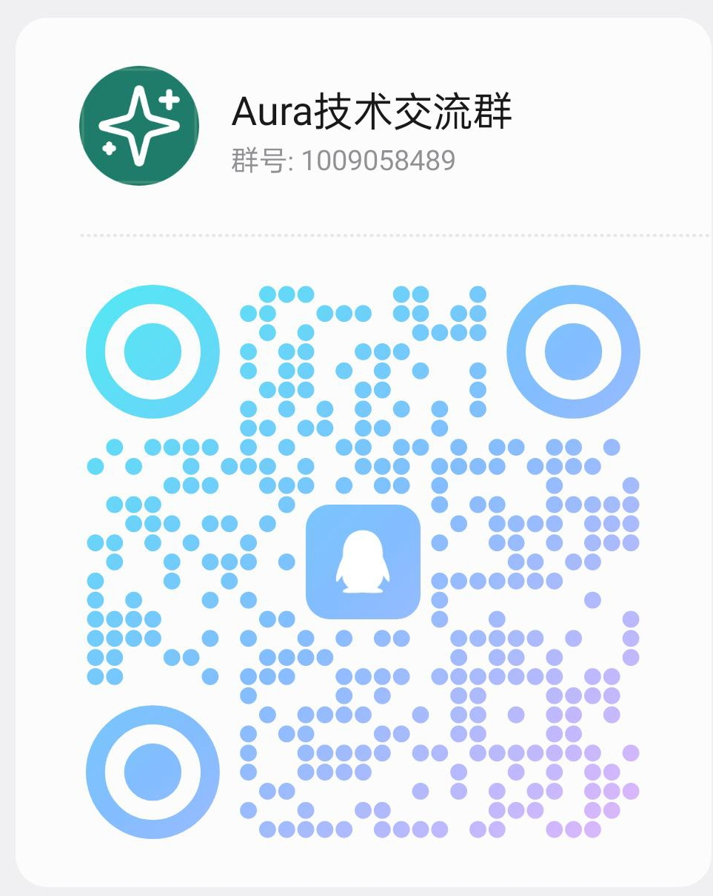

# Aura

### 优雅轻量的 Windows AI 语音输入工具

按一下右 Alt 开始说话。再按一下，整理好的文字就出现在光标处。

[使用场景](#-说一句就能做什么) · [快速上手](#-快速上手) · [申请密钥](#-申请两把-api-key) · [参与交流](#-qq-交流群)

## 🎙️ 说一句就能做什么

| 场景 | 怎么用 |
| --- | --- |
| 💬 **回消息、写邮件** | 在聊天框里按右 Alt，说完再按一次。Aura 整理口头重复和标点，把结果写入光标处。没有可写入的输入框时，可从剪贴板取用。 |
| ✍️ **改一段别扭的文字** | 选中一段文字，说「改自然一点」或「缩成一句话」。Aura 按要求替换选区，内置「去 AI 味」Skill 会照顾原有语气和事实。 |
| 🧩 **把想法交给 Agent** | 选中草稿，说「整理成给 Agent 的任务」。Prompt 工程 Skill 会把目标、约束和验收条件梳理清楚。也可以自定义、导入和导出 Skill。 |
| 🌍 **说中文回英文消息** | 用右 Alt + 右 Shift 开启翻译，说出你想表达的内容，把译文写回正在编辑的位置。 |

Aura 是 Typeless 和千问输入法语音功能的一种开源替代选择，适合在聊天、写作和 AI 编程之间频繁切换的 Windows 用户。

### ✨ 日常使用的细节

- **一枚跟手的浮窗。** 听写时，浮窗跟随输入位置所在的屏幕。可以在语音条或输入框附近预览，也能直接取消。
- **把常用名字听对。** 在个人词典里录入人名、项目名和术语，帮助文字整理保留正确拼写。听写历史可搜索，也可以关闭保存。
- **麦克风一眼就能测。** 在设置里看实时音量波形，确认设备选对了。快捷键也能按自己的习惯调整。
- **轻量启动。** Windows x64 安装包约 25 MiB，日常驻留托盘，无需下载本地推理模型。

### ⚡ 为什么是豆包

我们对比了日常听写和改写的响应速度、收尾等待和使用成本。在参与对比的组合里，**豆包流式 ASR 2.0 + Seed 2.0 Mini** 最符合 Aura 的需求：说话时持续识别，结束后较快拿到结果，调用成本也适合高频短句。这一版固定使用这套组合，填两把密钥即可开始。

## 🚀 快速上手

1. 从 [GitHub Releases](https://github.com/kgnbkgnb666/Aura/releases/latest) 下载 Windows x64 安装包并安装。
2. 从系统托盘打开「设置 → 模型服务」，填入下方申请的两把 API Key，点击页面底部「保存」。
3. 点击「测试连接」并说一句简短的话，确认语音识别和文字服务可用。
4. 把光标放进聊天框或编辑器，按右 Alt 开始说话，再按一次结束。

🔄 **升级 Aura**：在设置左下角点击 GitHub 图标右侧的「检查更新」。下载新版安装包后，保留原安装目录并覆盖安装，即可继续使用原来的听写历史、词典、Skill 和密钥设置。

## 🔑 申请两把 API Key

### 火山方舟 LLM Key

1. 注册并登录[火山方舟控制台](https://console.volcengine.com/ark/region:cn-beijing)。
2. 打开左侧「开通管理」，开通豆包 Seed 2.0 Mini 文本模型。
3. 打开「API Key 管理」，点击「创建 API Key」。
4. 填写备注并创建，复制生成的 Key。Key 通常只完整显示一次，请立即保存。
5. 回到 Aura 的「设置 → 模型服务」，粘贴到「火山方舟 API Key」。

方舟接口地址是 `https://ark.cn-beijing.volces.com/api/v3`。Aura 已经固定使用 `doubao-seed-2-0-mini-260428`。

[火山方舟官方快速入门](https://console.volcengine.com/ark/region%3Acn-beijing/docs/quick-start-beginner)

### 豆包流式 ASR 2.0 Key

1. 注册并登录[豆包语音控制台](https://console.volcengine.com/speech/app)。
2. 进入「开通管理」，开通「流式语音识别 2.0」。
3. 在左侧底部打开「API Key」，点击创建或获取 API Key。
4. 复制生成的 Key，回到 Aura 的「设置 → 模型服务」。
5. 粘贴到「豆包 ASR API Key」。两把密钥填好后点击页面底部「保存」。

Aura 使用实时接口 `wss://openspeech.bytedance.com/api/v3/sauc/bigmodel_async`，资源 ID 为 `volc.seedasr.sauc.duration`。

[豆包语音控制台快速入门](https://docs.volcengine.com/docs/doubao-voice/quick-start-new-console?lang=zh) · [实时语音识别接口](https://docs.volcengine.com/docs/doubao-voice/bidirectional-streaming-automatic-speech-recognition-websocket?lang=zh)

请妥善保管两个 Key。不要把它们提交到 GitHub 或发给其他人。

## ⭐ Star 历史

## 💬 QQ 交流群

欢迎来分享听写技巧、自定义 Skill 和使用反馈。遇到可复现的问题，也可以提交到 [GitHub Issues](https://github.com/kgnbkgnb666/Aura/issues)。

## License

[MIT](LICENSE)
