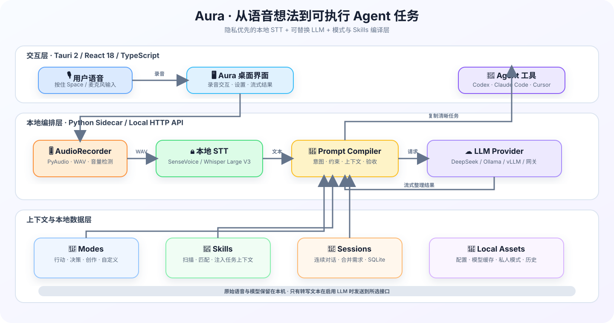
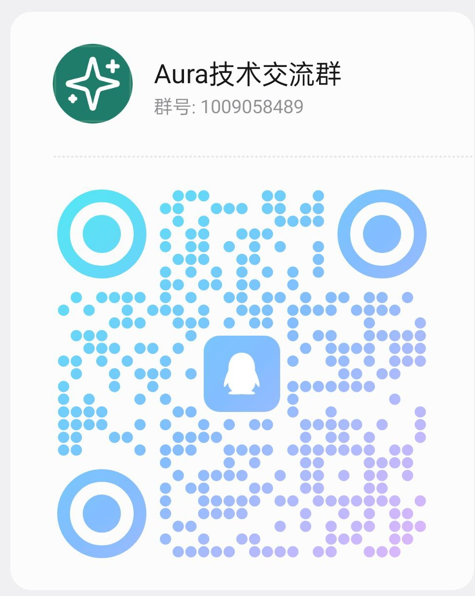

<div align="center">

[简体中文](README.md) · [English](README_EN.md) · [日本語](README_ja.md)

# ✨ Aura

### アイデアを話せば、AI エージェントが実行できる明確なタスクに

🎙️ ローカル音声認識 · 🧠 LLM によるタスク整形 · 🧩 スキルマッチング · 📋 エージェントに貼り付け

[](https://tauri.app/)
[](https://react.dev/)
[](https://www.python.org/)
[](LICENSE)

**プロンプトテンプレートを覚える必要はありません。考えを声に出せば、Aura が明確な問いに変えます。**

Aura が役に立ったら、ぜひ ⭐ Star をお願いします。

</div>

---

## 👀 30 秒でわかる Aura

```text
曖昧なアイデア → Space キーを押して話す → ローカル STT → LLM がタスクを整形
              → 目標、制約、受け入れ基準 → AI エージェントに貼り付け
```

Aura はチャットボットではありません。あなたと AI エージェントの間をつなぐ**表現レイヤー**です——あなたの意図を保ちながら、散らばった発話を明確で実行可能、検証可能なタスクに変えます。

## 🌌 Aura が生まれた理由

Codex、Claude Code、Cursor を開くと、カーソルが点滅しています。バグを直したい、機能を変更したい、あるいは漠然としたアイデアがある——しかし、目標、範囲、手順、完了の定義が一度に揃うことはありません。

それはコミュニケーションの失敗ではありません。**人間の思考は本来、曖昧なものから明確なものへと移り変わります。** 良いアイデアは、口に出し、文字で見て、修正し、詳細を加えることで現実になります。Aura はその最初の思考を受け止め、照らし出すためにあります。✨

```text
曖昧な思考 → 話す → Aura が最初の明確なバージョンを作成 → 磨き上げる → AI エージェントが実行
```

### 🎙️ なぜ音声か？

タイピングは「完璧な文章」を早すぎる段階で求めがちです。話すことで、迷い、文脈を補足し、考えを変え、感覚から始めることができます。言語モデルは、そうした不完全な手がかりから意図と構造を見つけるのが得意です。

| あなた | Aura | AI エージェント |
| --- | --- | --- |
| 🎤 自然に話す——フォーマット不要 | 🧩 目標、文脈、制約、優先順位を抽出 | 🤖 実行可能なタスクを受信 |
| ✍️ 初稿を確認・修正 | 🧠 より正確なリクエストに洗練 | 🚀 作業を実行 |

### 🚀 AI エージェント時代、うまく問うことが強み

エージェントが反復作業を担う時代、本当の問題を明確に表現できるかどうかが差別化要因になります。Aura は、**目標、判断、創造性**に集中できるようにし、入力ボックスを喜ばせるコツを覚える必要をなくします。

### 🛠️ 眠っているスキルを呼び覚ます

スキルはインストールしやすく、忘れやすいものです。Aura はスキルの説明をスキャンし、現在の意図にマッチする能力を自動的にタスクに含めます。

```text
「この研究をプレゼンにして」→ プレゼンスキルにマッチ → エージェント向けのブリーフを作成
```

すべてのスキル名を覚える必要はありません——何を達成したいかだけ覚えていれば十分です。🧩

---

## 📅 更新履歴

### 2026-07-25

**✨ 新機能: 問題明確度スコア**

- 音声入力後、AI が自動的に問題の明確さを評価し、パーセンテージのドーナツチャートで表示（緑/黄/赤で高/中/低を表現）
- 明確度の評価結果は SQLite に永続化され、同じ文字起こしなら毎回同じスコアを表示
- 「補足情報」機能を追加——AI が現在の文字起こしと会話履歴から 2〜4 の補足質問を生成、選択式回答（AI が単一選択/複数選択を自動判断）、カスタム入力にも対応
- 補足質問は文字起こし内容ごとにキャッシュされ、再表示時に一貫性を保持（「質問を更新」ボタンで手動更新可能）
- コピーボタンにフェードアウトアニメーションを追加

### 2026-07-22

**🔧 修正**

- パッケージングのバグ修正
- LLM 設定に「接続テスト」ボタンを追加

**📝 ドキュメント**

- README に QQ コミュニティグループを追加

### 2026-07-21

**🔧 修正**

- STT モデル読み込み失敗時の自動フォールバック：Whisper ダウンロード失敗時は SenseVoice Small に自動切替して設定を永続化
- 複数のパッケージングバグ修正

**📝 ドキュメント**

- README を再構成し明確化

### 2026-07-20

**✨ 新機能**

- 3 つの公式モード（アクション / 意思決定 / クリエイティブ）、カスタムモードとプライベートコピー対応
- UI テーマ切替（モーニング / ナイト）、簡体字中国語 / 繁体字中国語 / 英語 / 日本語対応
- STT モデル切替の改善
- LLM API キー保存のバグ修正

### 2026-07-18 ~ 07-19

**✨ 新機能**

- 設定ページ：音声モデル選択（SenseVoice Small / Whisper Large V3）
- UI テーマのビジュアル改善
- Windows インストーラー（NSIS）
- システムトレイ、自動起動
- 終了処理とログシステムの改善
- プレリリースビルド

### 2026-07-16 ~ 07-17

**✨ 新機能**

- コールドスタート最適化：起動画面にモデル読み込みプログレスバーを表示
- 編集モード：文字起こしとコンパイル結果を手動編集し、再コンパイル可能
- ローカルスキルのスキャンとマッチング
- セッション履歴：読み込み、削除、クリア

### 2026-07-10 ~ 07-12

**🎉 プロジェクト誕生**

- MVP 1.0：音声入力 → ローカル STT → LLM コンパイル → 結果コピー
- スキル設定ページ
- 文字起こし・コンパイル結果の編集サポート（初期版）
- 初期フレームワーク

---

## 🌟 機能一覧

- 🎙️ `Space` キーを押して録音、離して文字起こしと整理
- 🔒 ローカル音声認識：SenseVoice Small または Whisper Large V3
- 🧠 デフォルト DeepSeek、任意の OpenAI 互換 LLM エンドポイントも使用可能
- 🎯 3 つのモード：アクション / 意思決定 / クリエイティブ
- 🧩 ローカルスキルのスキャンとマッチング
- 📊 **問題明確度**：AI が各リクエストの明確さを評価し、ドーナツチャートで可視化
- 💡 **補足情報**：AI が補足質問を生成し、選択肢形式で不足情報の追加をガイド
- 🔁 会話コンテキストの保持、複数ターンの要件統合出力
- 📋 整理結果をワンクリックでコピー、Codex、Claude Code、Cursor などに貼り付け

## 🚀 クイックスタート

### 必要条件

- Windows 10 / 11
- Python 3.10 または 3.11
- Node.js 20.19+
- Rust stable
- Visual Studio C++ Build Tools

```powershell
git clone https://github.com/kgnbkgnb666/Aura.git
cd Aura

python -m venv .venv
.\.venv\Scripts\Activate.ps1
python -m pip install --upgrade pip
python -m pip install -r requirements.txt

npm ci
npm run tauri:dev
```

初回起動時に音声モデルが準備されます。その後 `Space` を押して最初のアイデアを話してください。🚀

| ショートカット | 機能 |
| --- | --- |
| `Ctrl + Shift + Space` | Aura を前面に表示 |
| `Space` 長押し | 録音（離して処理開始） |
| `Ctrl + N` | 新規セッション |
| `Esc` | Aura を隠す |

## 🧠 DeepSeek をデフォルト推奨する理由

Aura は主に話し言葉を理解し、目標と制約を抽出し、テキストを再構成します。毎回高価なモデルを必要とするタスクではありません。この用途では DeepSeek が十分な性能を発揮します：

- 💰 日常的な頻繁な使用に**手頃な価格**
- 🧱 **安定した** OpenAI 互換 API とストリーミング
- ⚡ 音声からタスクへの応答に**十分な速度**
- 🛠️ **シンプル**：`設定 → LLM` に DeepSeek API キーを入力するだけ

デフォルトは `deepseek-v4-flash`（思考モード無効）。より難しい作業には `deepseek-v4-pro` を選択するか、思考モードを有効にしてください。

> 🔐 開発環境ではキーはプロジェクトの `config.local.json` に保存されます。パッケージ版 Windows アプリでは `%LOCALAPPDATA%\Aura\config.local.json` に保存され、インストーラーには含まれません。平文で保存されるため、アップロードや共有は絶対にしないでください。

### 🔌 カスタム LLM エンドポイントの使用

`設定 → LLM → カスタムエンドポイント` を開き、OpenAI 互換の Base URL、モデル ID、API キーを入力してください。ローカルサービスはキーを空欄にできます。

| サービス | エンドポイント例 | モデル例 |
| --- | --- | --- |
| Ollama | `http://127.0.0.1:11434/v1` | `qwen3:8b` |
| vLLM | `http://127.0.0.1:8000/v1` | デプロイしたモデル ID |
| ゲートウェイ | `https://your-gateway.example/v1` | ゲートウェイ対応のモデル ID |

OpenAI Chat Completions 互換のホステッド、セルフホスト、ローカルサービスが使用可能です。利用可能な LLM がない場合、Aura はローカルのルールベースエンジンにフォールバックします。

## 🎧 音声モデル：選択、ダウンロード、拡張

| モデル | 強み | トレードオフ | 最適な用途 |
| --- | --- | --- | --- |
| **SenseVoice Small** | ⚡ 軽量・高速、中国語サポート良好 | 多言語/ノイズ音声では限界あり | 日常的な中国語音声入力 |
| **Whisper Large V3** | 🎯 高精度、多言語サポート | 約 3 GB、CPU では低速 | 多言語または高精度が必要な作業 |

`設定 → 音声` でモデルを選択。「モデルを事前読み込み」で事前にダウンロードと初期化が可能です。

- SenseVoice は ModelScope 経由で `models/modelscope/` にダウンロード
- Whisper は `models/huggingface/` にダウンロード
- Whisper は完全な CUDA 12 / cuDNN 9 環境があれば GPU 使用、なければ CPU `int8`
- Whisper のダウンロードがネットワークエラーで失敗した場合、SenseVoice Small に自動フォールバック

### モデルを事前ダウンロード

```powershell
# SenseVoice Small + VAD
$env:MODELSCOPE_CACHE = "$PWD\models\modelscope"
modelscope download --model iic/SenseVoiceSmall
modelscope download --model iic/speech_fsmn_vad_zh-cn-16k-common-pytorch

# Whisper Large V3（faster-whisper 形式）
hf download Systran/faster-whisper-large-v3 --cache-dir models/huggingface
```

必要に応じて CLI をインストール：

```powershell
python -m pip install -U modelscope huggingface_hub
```

## 🎯 モード：選択とカスタマイズ

| モード | 選ぶタイミング | 出力の重点 |
| --- | --- | --- |
| ⚡ **アクション** | やるべきことが決まっている：コード、ドキュメント、デバッグ、データ | 範囲、制約、成果物、受け入れ基準 |
| 🧭 **意思決定** | 選択が必要：トレードオフ、優先順位、方向性 | 事実 vs 仮定、選択肢、リスク、推奨事項 |
| 🎨 **クリエイティブ** | 探索が必要：コピー、命名、スクリプト、コンセプト | 対象者、トーン、創作の自由度、使える成果物 |

簡単に言えば：**アクション**は仕事を完了し、**意思決定**は良い選択をし、**クリエイティブ**は独創的なものを作ります。🤝

`設定 → モード` で有効化、無効化、並べ替え、追加が可能。公式モードを編集するとローカルのプライベートコピーが作成され、リポジトリの定義は上書きされません。

## 🏗️ アーキテクチャ



編集可能ソース：[docs/assets/aura-architecture.drawio](docs/assets/aura-architecture.drawio)

| レイヤー | 技術 / 役割 |
| --- | --- |
| デスクトップ UI | Tauri 2 + React 18 + TypeScript：録音、設定、結果編集 |
| ローカルサービス | Python sidecar + ローカル HTTP API：録音、STT、セッション、ストリーミング |
| 音声 | PyAudio、FunASR / SenseVoice、faster-whisper / CTranslate2 |
| コンパイラ | モード、セッションコンテキスト、スキルを DeepSeek またはカスタム LLM に送信 |
| ローカルデータ | 開発環境：プロジェクトルート。パッケージ版：`%LOCALAPPDATA%\Aura`（設定、SQLite 履歴、プライベートモード、モデルキャッシュ） |

## 📈 スター履歴

[](https://star-history.com/#kgnbkgnb666/Aura&Date)

## 🛠️ 開発

> Windows ではアップデートをインストールする前に Aura を閉じてください。インストーラーは `aura.exe` と `aura-sidecar.exe` を自動的に閉じてロックされたファイルを解放します。

### バージョン管理

`package.json` が唯一のバージョンソースです。1 つのコマンドですべてのパッケージメタデータを更新します：

```powershell
npm run release:version -- 0.1.3
```

`package.json`、`package-lock.json`、`src-tauri/tauri.conf.json`、`src-tauri/Cargo.toml` が同期されます。

```powershell
npm run build
python -m pytest
npm run tauri:dev
npm run build:sidecar
```

貢献方法は [CONTRIBUTING.md](CONTRIBUTING.md) をご覧ください。

<div align="center">

### 🌟 すべての曖昧な思考を、実行可能な次のステップに

Aura がお役に立てば、ぜひ ⭐ Star をお願いします。ありがとうございます！❤️

[問題を報告](https://github.com/kgnbkgnb666/Aura/issues) · [貢献する](CONTRIBUTING.md) · [MIT License](LICENSE)

---

### 💬 Aura 技術交流グループ

QQ 技術交流グループへようこそ！



</div>
