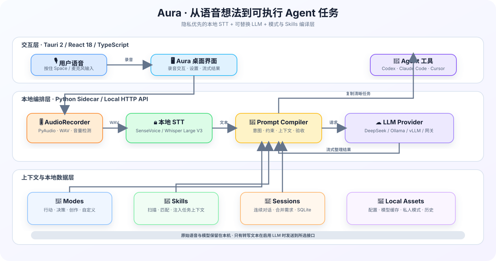

<div align="center">

[English](README.md) · [简体中文](README_zh-CN.md) · [日本語](README_ja.md)

# ✨ Aura

### 按住空格说出想法，把模糊念头变成 Agent 能直接执行的清晰任务

🎙️ 本地语音转写 · 🧠 LLM 智能整理 · 🧩 自动匹配 Skills · 📋 一键复制给 Agent

[](https://tauri.app/)
[](https://react.dev/)
[](https://www.python.org/)
[](https://www.microsoft.com/windows)
[](LICENSE)
[](https://github.com/kgnbkgnb666/Aura/stargazers)

**不用背 Prompt 模板。你只管思考，Aura 帮你把话问清楚。**

如果 Aura 对你有帮助，欢迎点一个 [⭐ Star](https://github.com/kgnbkgnb666/Aura) 支持项目继续更新！

</div>

---

## 👀 30 秒看懂 Aura

```text
模糊想法 → 按住 Space 说出来 → 本地 STT 转写 → LLM 按模式整理
        → 自动补全目标 / 约束 / 验收标准 → 复制给 Codex、Claude Code、Cursor…
```

Aura 不是另一个聊天机器人，而是人与 Agent 之间的“表达层”：保留你的真实意图，把零散口述整理成清晰、可执行、可验证的任务。

## 🌌 Aura 为什么存在？

你打开 Codex、Claude Code 或 Cursor，光标在闪。你知道自己大概要做什么：改一个功能、修一个 Bug，或记录一个还没成形的点子；但目标、边界、步骤和验收标准，往往并不会同时出现在脑中。

这不是不会表达。**人的思考，本来就是从模糊走向清晰。** 好想法通常不是先想完整再写下，而是在说出来、看见它、补充和修正的过程中成形。这就是 Aura 诞生的原因：它不要求你一开始就有答案，而是先接住想法，再陪你把它照亮。✨

```text
一个模糊的念头 → 先把它说出来 → Aura 给出第一版清晰表达
                  → 继续补充、修改 → Agent 可以准确执行的任务
```

### 🎙️ 为什么是语音？

思路还模糊时，打字容易让人过早追求“正确的句子”，反而打断思考。说话则允许你犹豫、补充、推翻，甚至先讲感受再靠近真正的问题；而大模型擅长从这些不完整的线索里识别意图与结构。

| 你 | Aura | Agent |
| --- | --- | --- |
| 🎤 自然地说，不用组织格式 | 🧩 理解目标、上下文、约束与重点 | 🤖 接收清晰、完整、可行动的任务 |
| ✍️ 看初版，再按真实想法修改 | 🧠 持续把表达整理得更准确 | 🚀 真正把事情做完 |

### 🚀 Agent 时代，差距在“怎么问”

AI 正在把大量重复劳动交给 Agent。人与人之间的差距，越来越不只在会不会使用模型，而在于能否把问题问清楚。Aura 希望让人专注于**目标、判断与创造**，而不是学习怎样讨好输入框；让每个人都能自然表达，再把意图翻译成 Agent 真正理解的任务。

### 🛠️ 让沉睡的 Skills 再次工作

你可能已经收藏或写过很多 Skills，却很难在需要时记起它们。Aura 会扫描 Skill 描述，按当前意图匹配相关能力并带入任务：

```text
“把这份调研整理成演示文稿” → 匹配演示文稿 Skill → 生成带工具、目标和交付要求的 Agent 任务
```

你不必记住每个 Skill 的名字；**记住自己想完成什么，就够了。** 🧩

### 🌟 核心能力

- 🎙️ **按住即说**：`Space` 录音，松开后自动转写与整理。
- 🔒 **本地 STT**：原始语音留在本机，支持 SenseVoice Small 与 Whisper Large V3。
- 🧠 **LLM 可替换**：默认推荐 DeepSeek，也支持任意 OpenAI-compatible 接口。
- 🎯 **三种任务模式**：行动、决策、创作，不同任务使用不同整理策略。
- 🧩 **Skill 匹配**：扫描本地 Skills，按当前任务自动补充适合的能力。
- 🔁 **连续上下文**：可以继续补充、修改，并选择是否合并本会话需求。
- 📋 **自动复制**：结果可直接粘贴到 Codex、Claude Code、Cursor 等 Agent。

## 🚀 快速开始

### 环境要求

- Windows 10 / 11
- Python 3.10 或 3.11
- Node.js 20.19+
- Rust stable
- Visual Studio C++ Build Tools

### 从源码运行

```powershell
git clone https://github.com/kgnbkgnb666/Aura.git
cd Aura

python -m venv .venv
.\.venv\Scripts\Activate.ps1
python -m pip install --upgrade pip
python -m pip install -r requirements.txt

npm ci
npm run tauri:dev
```

首次启动会准备所选的本地语音模型。完成后按住 `Space`，说出你的第一个想法 🚀

### 常用快捷键

| 快捷键 | 动作 |
| --- | --- |
| `Ctrl + Shift + Space` | ⚡ 唤起并聚焦 Aura |
| 按住 `Space` | 🎙️ 开始录音，松开后处理 |
| `Ctrl + N` | 📄 新建会话 |
| `Esc` | 🌙 隐藏窗口 |

## 🧠 为什么默认推荐 DeepSeek？

Aura 的主要任务是理解口语、提取目标与约束、重组文本，并不是需要超长推理链的科研级问题。对这类任务，DeepSeek 的能力已经**绰绰有余**：

- 💰 **便宜**：适合高频使用，不必为每次短文本整理承担较高成本。
- 🧱 **稳定**：OpenAI-compatible 接口成熟，流式输出和日常调用表现稳定。
- ⚡ **够快、够用**：语音转 Prompt 更看重响应速度、结构化表达和性价比。
- 🛠️ **配置简单**：进入 `设置 → LLM`，填写 DeepSeek API Key 即可。

项目默认使用 `deepseek-v4-flash` 并关闭思考模式；复杂任务可以切换 `deepseek-v4-pro` 或开启思考模式。模型名称以 DeepSeek 实际可用列表为准。

> 🔐 API Key 保存在本机 `config.local.json`，该文件已被 Git 忽略，但内容是明文，请勿上传或分享。

### 🔌 自定义 LLM 接口

进入 `设置 → LLM → 自定义接口`，填写：

1. **API 端点**：OpenAI-compatible 服务的 Base URL，通常以 `/v1` 结尾。
2. **模型名称**：服务端提供的真实 Model ID。
3. **API Key**：云服务按需填写；Ollama、vLLM 等本地服务通常可以留空。

| 服务 | API 端点示例 | 模型名称示例 |
| --- | --- | --- |
| Ollama | `http://127.0.0.1:11434/v1` | `qwen3:8b` |
| vLLM | `http://127.0.0.1:8000/v1` | 服务启动时指定的模型 ID |
| 第三方网关 | `https://your-gateway.example/v1` | 网关支持的模型 ID |

只要接口兼容 OpenAI Chat Completions，就可以接入自建服务、本地模型或其他云厂商。没有配置可用 LLM 时，Aura 仍会使用本地规则整理器提供基础体验。

## 🎧 STT 模型：选择、下载与扩展

### 怎么选？

| 模型 | 优点 | 代价 | 推荐场景 |
| --- | --- | --- | --- |
| **SenseVoice Small** | ⚡ 轻量、启动快、中文表现好 | 多语言与复杂环境上限较低 | 中文口述、普通电脑、日常高频使用 |
| **Whisper Large V3** | 🎯 多语言、高精度、抗口音更强 | 约 3 GB；CPU 推理较慢 | 多语言、嘈杂环境、准确率优先 |

进入 `设置 → 语音 → 语音识别模型` 即可切换。点击“预加载模型”可以提前完成下载和初始化；模型缓存根目录也可以在同一页面修改。

### 自动下载

- SenseVoice Small 首次使用时通过 ModelScope 下载到 `models/modelscope/`。
- Whisper Large V3 首次使用时下载到 `models/huggingface/`。
- Whisper 检测到完整 CUDA 12 / cuDNN 9 环境时使用 NVIDIA GPU，否则自动回退到 CPU `int8`。
- Whisper 因网络问题下载失败时，Aura 会自动切回 SenseVoice Small，避免应用无法启动。

### 手动提前下载

网络较慢时，可以在项目根目录先准备缓存：

```powershell
# SenseVoice Small + VAD
$env:MODELSCOPE_CACHE = "$PWD\models\modelscope"
modelscope download --model iic/SenseVoiceSmall
modelscope download --model iic/speech_fsmn_vad_zh-cn-16k-common-pytorch

# Whisper Large V3（faster-whisper 转换版）
hf download Systran/faster-whisper-large-v3 --cache-dir models/huggingface
```

如果没有 `modelscope` 或 `hf` 命令：

```powershell
python -m pip install -U modelscope huggingface_hub
```

中国大陆网络下，Whisper 默认会尝试 Hugging Face 镜像；也可以通过 `HF_ENDPOINT`、`HF_MIRROR` 或 `HF_NO_MIRROR=1` 自定义下载源。

### 添加自己想要的 STT 模型

当前版本的设置页只内置两种 Provider，**还不支持直接导入任意模型文件**。开发者可以按现有接口接入新模型：

1. 在 `aura/providers/stt/` 新建 Provider，实现 `name`、`load_model()`、`transcribe()`、`status`、`progress`、`last_error` 和 `is_ready`。
2. 在 `aura/providers/stt/__init__.py` 导出新 Provider。
3. 在 `aura/config.py` 的 `SUPPORTED_STT_PROVIDERS` 注册 ID。
4. 在 `AuraService._build_transcriber()` 中建立 Provider ID 与实现类的映射。
5. 在 `src/App.tsx` 的语音模型下拉框和 `src/i18n.ts` 中补充选项与说明。
6. 把模型文件放入“模型缓存目录”的独立子目录，并为下载、校验、CPU/GPU 回退补充测试。

可以参考 `SenseVoiceSmallTranscriber` 与 `WhisperLargeV3Transcriber` 的实现。欢迎提交新的 STT Provider PR 🎉

## 🎯 模式怎么选、怎么改？

模式决定 Aura 用什么标准整理你的口述，而不是简单更换几个同义词。

| 模式 | 什么时候选 | 输出重点 |
| --- | --- | --- |
| ⚡ **行动模式** | 已经知道要做什么：改代码、写文档、排错、处理数据 | 范围、步骤、约束、交付物、验收标准 |
| 🧭 **决策模式** | 还在选方向：方案比较、优先级、产品与技术决策 | 事实与假设、选项权衡、风险、明确建议 |
| 🎨 **创作模式** | 需要探索表达：文案、命名、脚本、视觉概念 | 受众感受、创作空间、辨识度、可用成品 |

一个简单判断：**要“做完”选行动，要“选对”选决策，要“想出好东西”选创作。** 🤝

### 在界面中修改

进入 `设置 → 模式`：

- ✅ 启用或停用模式；只有启用的模式会出现在主界面。
- ↕️ 调整模式顺序。
- ➕ 新建自定义模式，修改名称、描述、系统提示词和输出提示。
- 📝 编辑官方模式时，Aura 会保存为本地私人副本，不覆盖仓库中的官方定义。

官方模式位于 `modes/official/*.yaml`；自定义模式、私人副本、启用状态和排序保存在 `.aura-local/modes/`，不会提交到 Git。至少需要保留一个启用模式。

## 🏗️ 技术架构



可编辑源图：[docs/assets/aura-architecture.drawio](docs/assets/aura-architecture.drawio)

| 层 | 技术 / 职责 |
| --- | --- |
| 桌面界面 | Tauri 2 + React 18 + TypeScript，负责录音交互、设置与结果编辑 |
| 本地服务 | Python Sidecar + 本地 HTTP API，编排录音、转写、会话与流式输出 |
| 语音层 | PyAudio、FunASR / SenseVoice、faster-whisper / CTranslate2 |
| 编译层 | 模式 Prompt + 会话上下文 + Skills，调用 DeepSeek 或自定义 LLM |
| 本地数据 | `config.local.json`、SQLite 历史、`.aura-local/` 私人资产、模型缓存 |

## 🛠️ 开发与验证

```powershell
# 前端构建
npm run build

# Python 测试
python -m pytest

# 桌面开发模式
npm run tauri:dev

# 构建 Python sidecar
npm run build:sidecar
```

欢迎贡献模式、STT Provider、LLM 兼容性、Skills 与产品体验。提交前请阅读 [CONTRIBUTING.md](CONTRIBUTING.md)。

## 📈 Star 增长曲线

> 📊 Star History 会在项目发布到正确的 **公开 GitHub 仓库** 后显示。当前仓库地址不可公开访问，第三方图表服务会返回 500；发布后把下方的 `<OWNER>/<REPO>` 替换为真实仓库即可。

```md
[](https://star-history.com/#<OWNER>/<REPO>&Date)
```

<div align="center">

### 🌟 让每一个模糊念头，都能变成可执行的下一步

如果这个项目对你有用，请给 Aura 一个 [⭐ Star](https://github.com/kgnbkgnb666/Aura)；你的支持会让更多人看到它，也会推动项目继续更新。谢谢！❤️

[报告问题](https://github.com/kgnbkgnb666/Aura/issues) · [参与贡献](CONTRIBUTING.md) · [MIT License](LICENSE)

</div>
